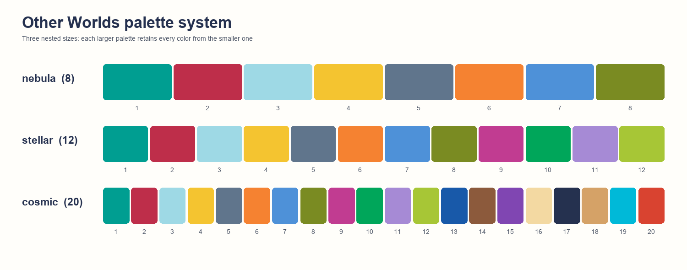
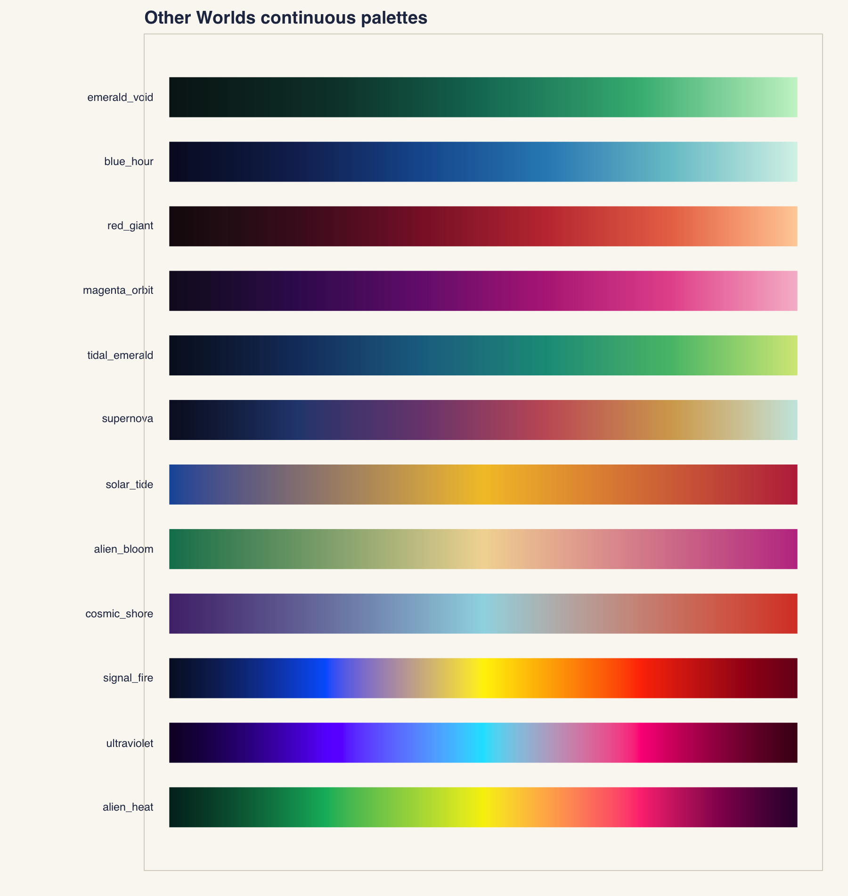

# otherworldspalettes

**Art-inspired color palettes for R and ggplot2.** From the *Other Worlds* artwork: vivid qualitative colors, atmospheric sequential gradients, and diverging heatmap scales for scientific graphics.



**[Explore all palettes and figures](docs/vignette-gallery.md)** · [Palette reference and guidance](docs/palette-guide.md) · [Interactive swatch explorer](inst/explorer/index.html)

## Install

Install from GitHub with [pak](https://pak.r-lib.org/):

```r
install.packages("pak") # once, if needed
pak::pak("aolow/otherworldspalettes")
```

## Get started

```r
library(otherworldspalettes)
library(ggplot2)

# Browse the available named palettes.
otherworlds_palettes()
otherworlds_continuous_palettes()

# Categorical colors for up to 8 groups.
otherworlds_palette(8, "nebula")

# Plot with an explicit palette selection.
ggplot(iris, aes(Sepal.Length, Sepal.Width, color = Species)) +
  geom_point(size = 2.5) +
  scale_colour_otherworlds(palette = "nebula")

# Continuous values.
ggplot(faithfuld, aes(waiting, eruptions, fill = density)) +
  geom_raster() +
  scale_fill_otherworlds_c(palette = "tidal_emerald")
```

## Choose a palette

| What you're showing | Start with | Other choices |
| --- | --- | --- |
| Categories on light backgrounds, up to 8/12/20 | `nebula` | `stellar`, `cosmic` |
| Many categories, up to 40 | `galaxy40` | `galaxy40_max` |
| Categories on dark backgrounds, up to 8/12/20 | `eclipse` | `afterglow`, `deepfield` |
| Ordered measurements or intensity | `tidal_emerald` | `blue_hour`, `supernova` |
| Signed values centered at zero | `ion_balance` | `stellar_balance`, `ember_balance` |
| Expressive or illustrative heatmaps | `solar_tide` | `alien_bloom`, `cosmic_shore`, `signal_fire`, `ultraviolet`, `alien_heat` |

The 8-, 12-, and 20-color families are **nested**, so their original colors stay the same as you expand the number of groups. Keep factor levels fixed across figures to retain group-to-color assignments.

`galaxy40` preserves the first 20 `cosmic` color assignments; `galaxy40_max` instead optimizes all 40 colors jointly. Use either for *categories*, not continuous values.



For swatches, scientific figure previews on white **and** dark backgrounds, and side-by-side comparisons, visit the **[visual gallery](docs/vignette-gallery.md)**.

## Examples and documentation

- [Visual gallery](docs/vignette-gallery.md): GitHub-rendered previews of light figures, heatmaps, Galaxy 40, astronomy examples, and dark slides.
- [Palette guide](docs/palette-guide.md): every family, usage details, selection advice, reproducible examples, and accessibility notes.
- [Scientific figures](vignettes/scientific-figures.Rhtml), [heatmaps](vignettes/heatmaps.Rhtml), [space figures](vignettes/space-figures.Rhtml), [Galaxy 40](vignettes/galaxy40.Rhtml), and [dark slides](vignettes/dark-slides.Rhtml): executable Rhtml vignette source files.

## The art behind the colors

The palettes grew out of my *Other Worlds* paintings and drawings, an exploration of imagined landscapes, otherworldly light, and cosmic atmospheres. That artwork also inspired [*Other Worlds*, my coloring and creative activity book](https://www.olaolowart.com/other-worlds).

My work spans both art and science. This R package translates the artwork's color relationships into a practical set of choices for scientific figures. These are artist-directed adaptations, not literal color extractions from individual book pages.

[Explore the book and my other artwork](https://www.olaolowart.com/) · [View the palette gallery](docs/vignette-gallery.md)

## Responsible use

These palettes are design tools, **not certified perceptually uniform or color-vision-accessible colormaps**. Use labels, shapes, and facets when categories are hard to distinguish. For signed heatmaps, set limits symmetrically around zero when zero should map to the midpoint. Test contrast and readability on the intended background, especially for small points, thin lines, and projected slides.

MIT licensed. See [LICENSE](LICENSE) and [NEWS](NEWS).
