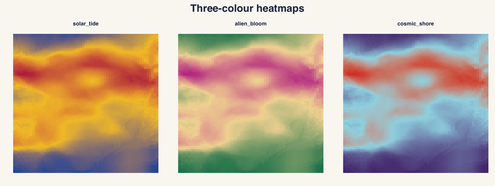
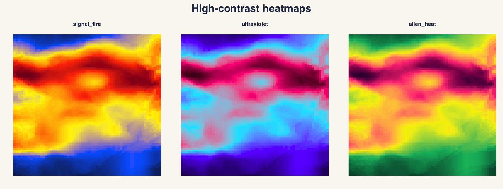

# otherworldspalettes

`otherworldspalettes` provides qualitative and continuous colour palettes
derived from the *Other Worlds* art project. Discrete colours are deliberately
ordered so neighbouring series jump across hue and lightness; continuous maps
move smoothly through deep-space shadows into luminous atmospheric colour.

## From the artwork to the palettes

*Other Worlds* grew out of my original paintings and drawings of imagined
landscapes, strange skies, and cosmic light. Those images also inspired
[*Other Worlds*, my coloring and creative activity book](https://www.olaolowart.com/other-worlds),
which invites readers to explore color, texture, light, and atmosphere in
their own way.

I work in both art and science, and this R package brings those two interests
together. The palettes translate the mood and color relationships of the
artwork into a practical vocabulary for scientific graphics. They are
artist-directed adaptations for visualization, not exact reproductions of
individual book pages or a claim of universal perceptual uniformity.

## Palettes


The package contains three **nested sizes of one palette system**, rather than
three unrelated colour schemes:

- `nebula` contains 8 colours and is the recommended default for most figures.
- `stellar` contains the same 8 colours plus 4 additional colours, for 12 total.
- `cosmic` contains all `stellar` colours plus 8 additional colours, for 20 total.

Because the palettes are nested, you can expand from `nebula` to `stellar`
or `cosmic` without changing the existing palette entries. Within each
palette, the order jumps across hue and lightness to keep neighbouring groups
visually distinct.

For consistent group-to-color assignments across figures, also keep the
category or factor level order fixed in your plotting code. The package's
accessors and ggplot2 scales default to `cosmic`; explicitly select
`palette = "nebula"` for the recommended eight-color starting point.

## Installation

```r
# install.packages("pak")
pak::pak("aolow/otherworldspalettes")
```

## Use

```r
library(ggplot2)
library(otherworldspalettes)

otherworlds_palettes()

nebula <- otherworlds_palette(8, "nebula")
stellar <- otherworlds_palette(12, "stellar")
cosmic <- otherworlds_palette(20, "cosmic")

# Optional ggplot2 scales
ggplot(iris, aes(Sepal.Length, Sepal.Width, colour = Species)) +
  geom_point(size = 2) +
  scale_colour_otherworlds("Species", palette = "nebula")
```

The palettes are intended for qualitative data. For accessibility, do not rely
on colour alone when many groups are present: add direct labels, shapes, line
types, or facets. The 8-colour `nebula` palette is the preferred default for
figures that must remain easy to distinguish in print.

## Continuous palettes


The package includes six sequential, dark-to-light palettes. The first
four explore a focused hue family; the final two move across hues in the spirit
of perceptually smooth scientific colour maps.

- `emerald_void` — mineral greens and luminous emerald.
- `blue_hour` — midnight indigo through atmospheric cyan.
- `red_giant` — oxblood, nebula red, and warm stellar light.
- `magenta_orbit` — deep violet through ion pink.
- `tidal_emerald` — blue-black through tidal blue and emerald to alien light.
- `supernova` — shock blue through dusty violet, nebula coral, and ejecta gold
  to an icy ionized core.

Three additional palettes are designed for heatmaps and centered data. Each
passes through a bright middle colour drawn from the paintings rather than a
generic white midpoint.



- `solar_tide` — deep blue through sun yellow to nebula red.
- `alien_bloom` — emerald through warm cream to orbit magenta.
- `cosmic_shore` — royal purple through atmospheric cyan to vermilion.

For dense heatmaps, three higher-contrast options use darker poles, luminous
centers, and more saturated transitions:

- `signal_fire` — deep space and electric blue through solar yellow to flare
  orange and dark red.
- `ultraviolet` — violet-black and electric violet through ion cyan to hot
  magenta and deep wine.
- `alien_heat` — forest void and emerald through acid yellow to orbit magenta
  and deep plum.



### Neutral-centered maps for scientific comparisons

Three additional diverging palettes have a light, neutral central anchor:

- `ion_balance` pairs ocean blue with iron red.
- `stellar_balance` pairs violet shadows with warm umber.
- `ember_balance` pairs deep teal with muted raspberry.

These provide a calmer alternative to the painting-led gradients for signed
effects, standardized expression differences, and fold-change heatmaps.
They are design candidates, **not yet certified perceptually uniform or
color-vision-deficiency-safe**. Compare against a validated colormap for
high-stakes numeric interpretation.

For centered, signed data (such as changes relative to a baseline), set
symmetric color limits around zero if zero should align with the middle
color. These artist-inspired gradients have not been established as
perceptually uniform or color-vision-deficiency-safe; for quantitative
interpretation, check the rendered figure and consider labels or a
validated scientific colormap as a comparison.

See `vignette("heatmaps", package = "otherworldspalettes")` for side-by-side
examples and guidance on choosing a palette.

```r
otherworlds_continuous_palettes()
cols <- otherworlds_continuous_palette(100, "tidal_emerald")

ggplot(faithfuld, aes(waiting, eruptions, fill = density)) +
  geom_raster() +
  scale_fill_otherworlds_c(palette = "supernova")

# Three-colour heatmap
heatmap(volcano, col = otherworlds_continuous_palette(101, "solar_tide"))
```

## Choosing a palette

| Data | First choice | Notes |
| --- | --- | --- |
| Categorical, up to 8 groups | `nebula` | Also use shapes or labels |
| Categorical, 9 to 12 | `stellar` | Check small marks carefully |
| Categorical, 13 to 20 | `cosmic` | Prefer faceting when feasible |
| Ordered magnitude | `tidal_emerald`, `blue_hour` | Check lightness ordering |
| Signed, centered values | `ion_balance`, `stellar_balance`, `ember_balance` | Fix symmetric scale limits |
| Expressive/artistic heatmaps | `alien_heat`, `ultraviolet`, `solar_tide` | Highly saturated centers can exaggerate zero |

For a local interactive swatch explorer, open
[`inst/explorer/index.html`](inst/explorer/index.html) in a browser.
To see realistic scientific plots, see
`vignette("scientific-figures", package = "otherworldspalettes")`.
To run checks, use `R CMD check .` or the GitHub Actions workflow.

### Signed heatmap example

```r
library(ggplot2)
z <- as.matrix(scale(USArrests))
m <- as.data.frame(as.table(z))
names(m) <- c("state", "feature", "zscore")
ggplot(m, aes(feature, state, fill = zscore)) +
  geom_tile() +
  scale_fill_otherworlds_c(
    palette = "ion_balance",
    limits = c(-max(abs(m$zscore)), max(abs(m$zscore)))
  )
```

The negative and positive ends should be equally far from zero. If you use
asymmetric limits, the visual midpoint no longer represents zero.

## Interpretation and accessibility

These are art-derived colors intended for figures, not calibrated measurements.
Color contrast depends on mark size, background, display, and print process.
Test grayscale and common color-vision deficiencies, label critical findings,
and never encode a consequential distinction by color alone. Adjacent
categorical colors are ordered for visual distinction, but no formal
accessibility guarantee is asserted.
