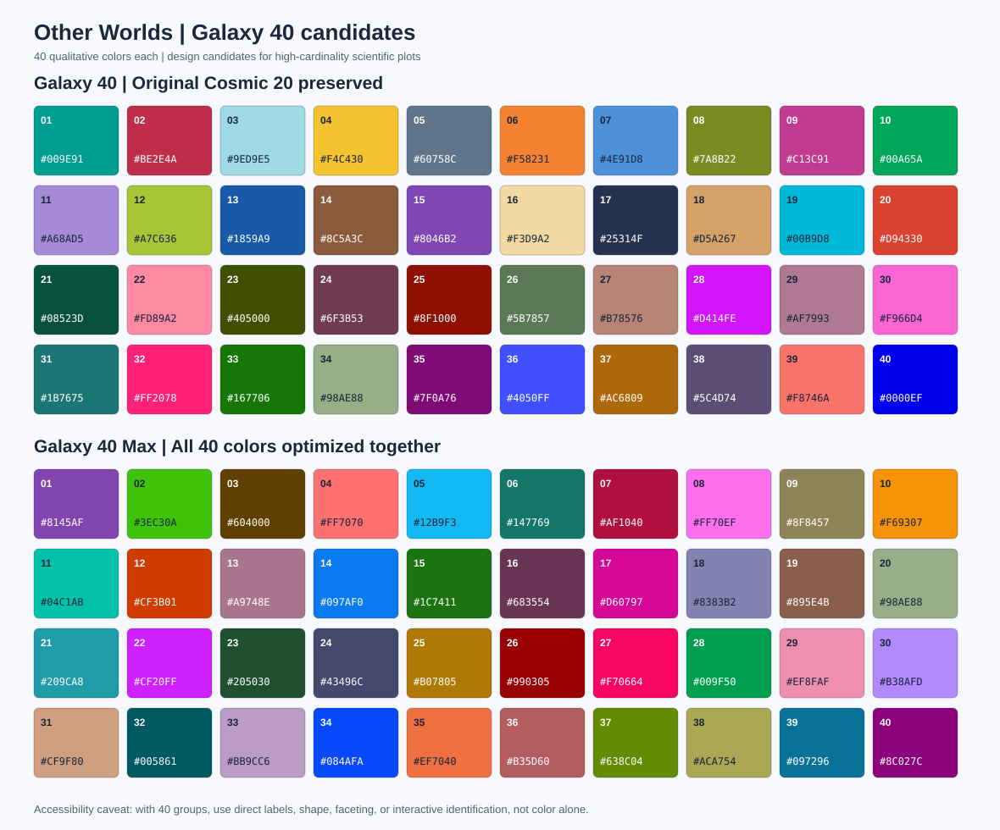

# Galaxy 40 experimental palette comparison

**Status:** review candidates, not merged or accessibility-certified. The
original `nebula`, `stellar`, and `cosmic` values are unchanged.

## Why two versions?

| Candidate | Existing `cosmic` colors | Priority |
| --- | --- | --- |
| `galaxy40` | Preserves all 20 colors and names, in order | Stable assignments across projects |
| `galaxy40_max` | Independently selects all 40 | Better worst-case combined perceptual screening score |

Both are **qualitative** palettes, not diverging numeric scales. Forty
categories can be difficult to identify even if every hex value is unique.
A larger number of distinct colors does not make 40-category scatter plots
automatically readable, particularly with tiny points or high overplotting.

## Proposed method

The deterministic source is [`generate.py`](generate.py) with seed
`20261017`. It uses Python NumPy, SciPy and scikit-image **only to design**
the fixed palette values. They are not runtime dependencies of the R package.

1. Build a dense sRGB candidate pool, and filter it to approximately
   L* 29–80, C* ≥22, white background contrast ≥2.25, and black background
   contrast ≥2.2. The original twenty are exempt from these filters.
2. Convert each candidate to CIE Lab, and also simulate **approximate**
   protan and deutan shifts by mixing a 100% Machado-inspired linear-RGB
   matrix transform at severity 65%.
3. Select colors iteratively by the worst CIEDE2000 distance to an already
   selected color. Each step scores the smallest of the normal-vision
   distance and 1.3 times each simulated-vision distance. A small
   preference for hues near original Other Worlds colors acts as an
   artistic tie-breaker.
4. For `galaxy40`, seed the search with the exact existing twenty.
   For `galaxy40_max`, try multiple initializations and retain the
   candidate with the highest minimum composite score.

This is **Glasbey-inspired greedy maximin selection**, not a proof of a
globally optimal 40-color set. The simulation and distance model cannot
guarantee accessibility for any given person.

For methodological context:
- Glasbey, van der Heijden, Toh, and Gray (2007),
  [Colour displays for categorical images](https://doi.org/10.1002/col.20327).
- [Colorcet categorical palette guidance](https://colorcet.holoviz.org/user_guide/Categorical.html).
- [Glasbey accessibility guidance](https://glasbey.readthedocs.io/en/latest/color_vision_deficiency.html).

## Diagnostic comparison

Computed on all unordered color pairs using the saved candidate swatches.
Numbers are exploratory optimization diagnostics, not psychophysical
discrimination thresholds:

| Measurement | Cosmic 20 | Galaxy 40 | Galaxy 40 Max |
| --- | ---: | ---: | ---: |
| Minimum **normal-vision** CIEDE2000 | 13.07 | 13.07 | 12.93 |
| Minimum **combined** normal/approx. protan/deutan CIEDE2000 proxy | 9.80 | 9.80 | 12.92 |
| Colors with **white** contrast less than 3:1 | 8 | 12 | 13 |

The compatibility palette cannot improve the original twenty's weakest
pair because it retains those colors. The optimized palette improves
the minimum combined proxy, but its worst normal-vision distance is
similar, and several colors still have insufficient white contrast for
small filled marks.

**Do not equate these scores with guaranteed distinctness.**
They are sensitive to simulated severity, gamut filtering, background,
display calibration, and the size of plotted marks. Quantitative
continuous maps should be evaluated separately.

## Where to test before merging

- Dense 40-cluster single-cell UMAPs with small dots and transparency.
- Heatmap annotation strips with legend keys 5–10 pixels wide.
- Multi-series line plots with varied line widths and symbols.
- Light, dark, grayscale, printed figures, and color-vision simulations.
- Stable category-to-color mapping when growing an analysis from 20 to 40 groups.

Recommended label-first practice for an atlas: display direct cluster IDs,
then use interactive hover or a separate key to resolve biological labels.
If related cell populations need systematic hues, a *hierarchical*
qualitative palette may be more useful than either maximin set.



## Reproduce

```sh
python -m pip install numpy scipy scikit-image
python design/galaxy40/generate.py
```

The generated `galaxy40.json` and `galaxy40_max.json` are intended
for comparison against the hardcoded R values. Minor numerical changes
in library versions may affect greedy ties. Keep published hex codes fixed
once the palette has been approved.
