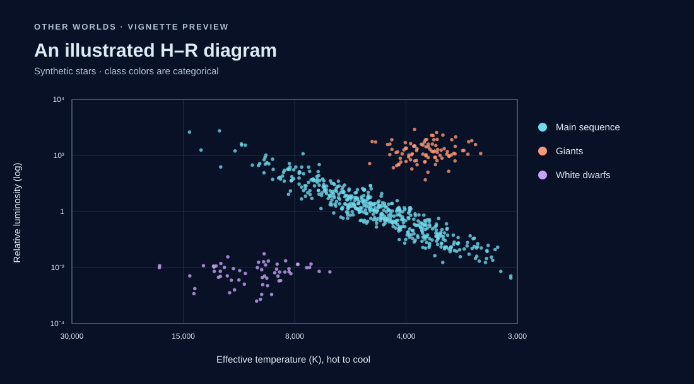
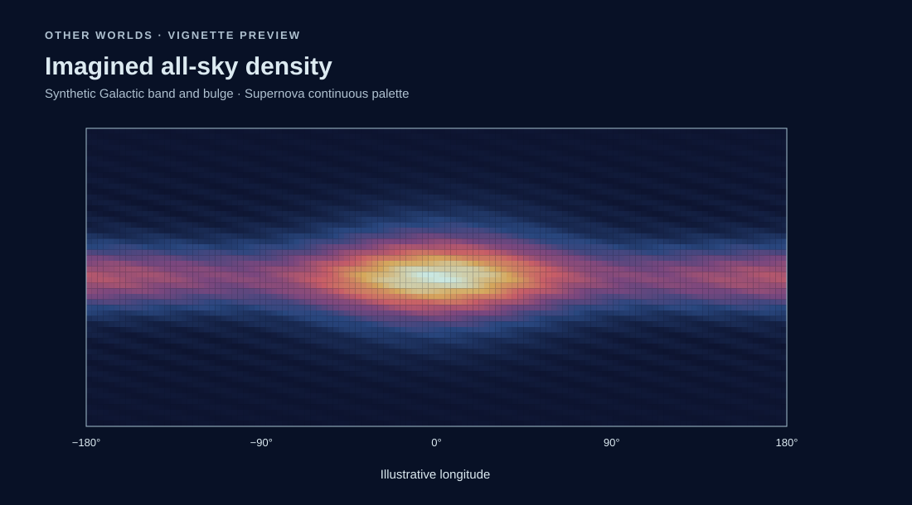
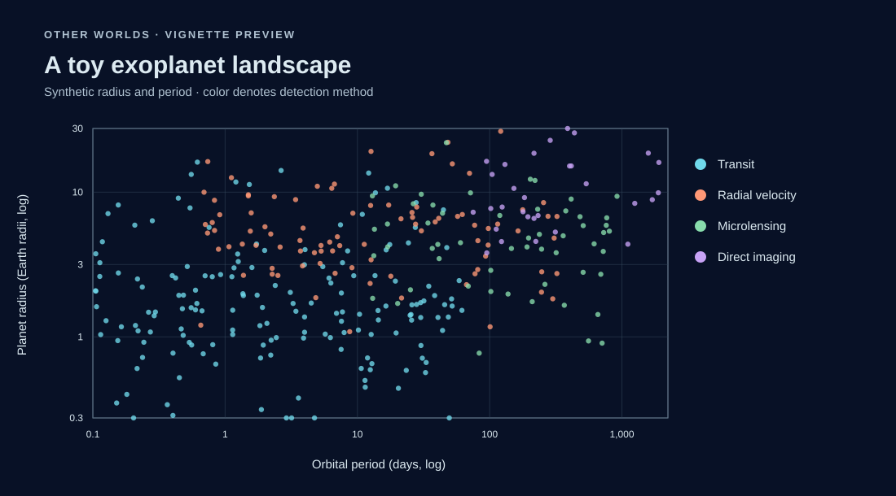
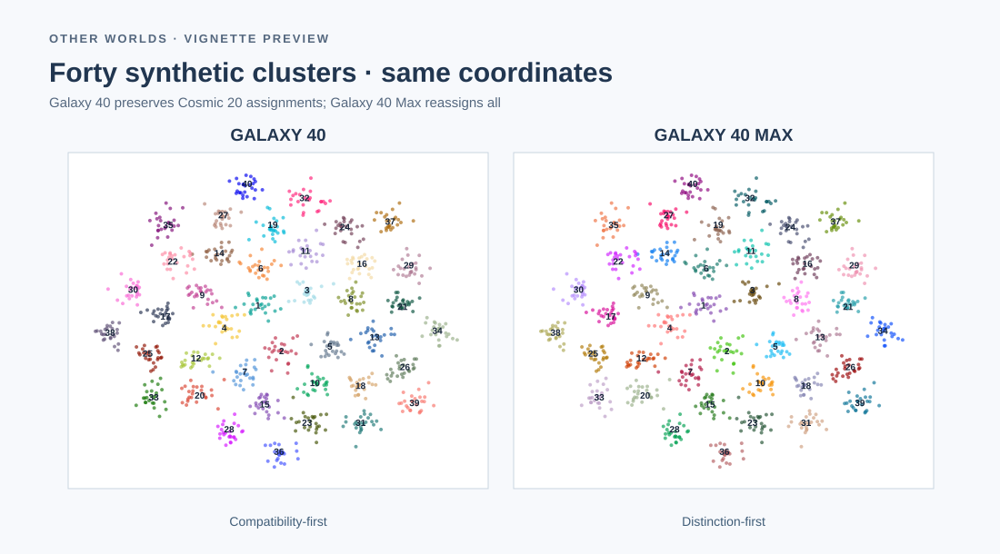
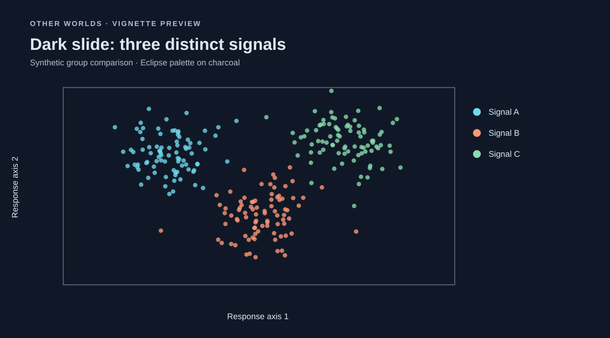
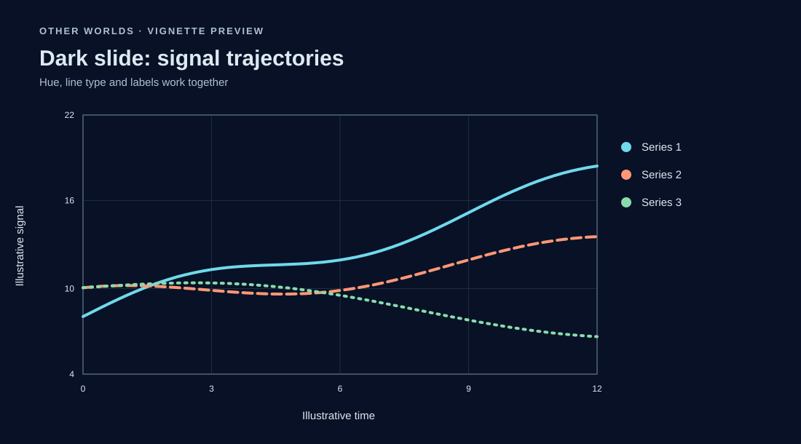
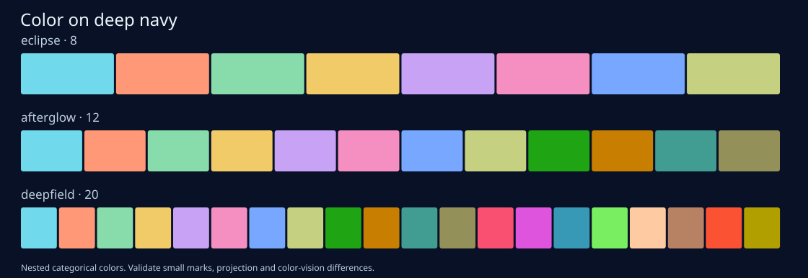

# Visual vignette gallery

**View figures directly on GitHub**, without needing R or opening the `.Rhtml` source files.

These browser-viewable **SVG visual previews** recreate the plots using the same stored palette hex colors and synthetic-data recipes. They are **illustrative representations**, not images exported from the installed R vignette engine. The original Rhtml files remain executable sources, and their exact random draws can differ.

## Space figures

### 1. Hertzsprung–Russell-style diagram

The three colored classes are simulated stellar populations, not observations.

### 2. All-sky density field

An equirectangular synthetic Galactic band and central bulge, using a Supernova-inspired sequential gradient.

### 3. Exoplanet-style scatterplot

Simulated exoplanet detections on logarithmic axes, grouped by method.

### 4. Galaxy 40 comparison

The exact stored colors in both 40-category palettes on the same synthetic cluster geometry.

[Executable space-figures vignette](../vignettes/space-figures.Rhtml) · [Executable Galaxy 40 vignette](../vignettes/galaxy40.Rhtml)

## Dark slides

### 5. Scatterplot on charcoal

### 6. Lines on navy

### 7. Full dark color family

[Executable dark-slides vignette](../vignettes/dark-slides.Rhtml)

---

**Design caveats:** These palettes are not certified for color-vision accessibility or calibrated quantitative inference. Use direct labels, consider line types and shapes, and inspect plots in the intended viewing environment. Dark discrete colors do not replace sequential or diverging numeric colormaps.
