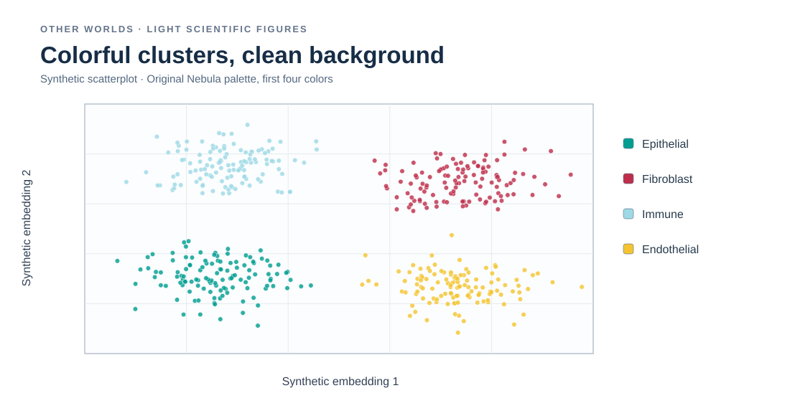

# Visual palette and vignette gallery

View the palettes and scientific figure previews **directly on GitHub**, without installing R. Start with light-background scientific figures, then explore high-cardinality examples, continuous heatmaps, and dark-slide options.

The original palette strip images are package assets. The chart SVGs below are illustrative recreations using the actual hex values and synthetic examples, **not renders exported from the R vignette engine**.

## 1. Light-background categorical palettes

Best starting point for conventional papers, reports, and white-background plots.

**Nebula (8)** is the recommended starting point, **Stellar (12)** and **Cosmic (20)** preserve the same first colors as you increase category count.

### Example: scientific figure on white

[Executable scientific-figures vignette](../vignettes/scientific-figures.Rhtml)

## 2. Continuous palettes and heatmaps

These gradients are designed for ordered quantities and for heatmaps, **not** for cluster identity labels.

### Six sequential gradients

### Painting-derived diverging gradients

### Expressive high-contrast heatmaps

The additional **neutral-centered** palettes, `ion_balance`, `stellar_balance`, and `ember_balance`, are intended for signed effects and comparisons relative to zero. In those plots, use symmetric color limits. All quantitative palettes still require validation for perceptual interpretation.

[Executable heatmaps vignette](../vignettes/heatmaps.Rhtml)

## 3. Many categories: Galaxy 40 comparison

The same synthetic clusters appear with two competing color assignments, on a light background. **Galaxy 40** preserves Cosmic 20's first 20 assignments, while **Galaxy 40 Max** prioritizes overall separation without that compatibility requirement.

[Executable Galaxy 40 vignette](../vignettes/galaxy40.Rhtml)

## 4. Space-inspired figures

These are **synthetic**, not astronomical observations. They demonstrate different plotting tasks.

### Hertzsprung–Russell-style diagram

### All-sky density field

### Exoplanet-style scatterplot

[Executable space-figures vignette](../vignettes/space-figures.Rhtml)

## 5. Dark-background figures and slides

These are alternative palettes for navy, charcoal, or black, **not** replacements for the original color families.

### Eclipse (8), Afterglow (12), Deepfield (20)

### Scatterplot and line chart examples

[Executable dark-slides vignette](../vignettes/dark-slides.Rhtml)

---

**Accessibility and provenance:** The illustrative chart previews are not an accessibility certification or faithful captures of Rhtml execution. Color performance depends on the background, shape, opacity, mark size, and viewing context. Label important differences, and use a validated quantitative colormap when the accuracy of the color encoding is consequential.
